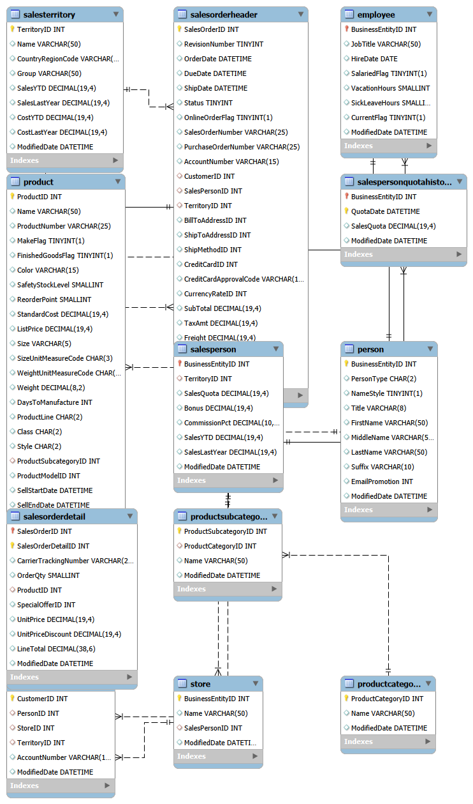

# Analyse SQL des performances commerciales – AdventureWorks

Projet d'analyse de données réalisé en **SQL (MySQL)** sur la base **AdventureWorks**, un fabricant et distributeur de vélos, de pièces et d'accessoires présent dans plusieurs pays.

Le projet est construit comme une mission réelle : le **directeur commercial** pose 8 questions avant son comité de direction, et chaque question donne lieu à une analyse SQL, puis à des conclusions et des recommandations.

## Contexte et données

- **Base** : AdventureWorks (version complète, 12 tables liées aux ventes), importée dans MySQL.
- **Période** : du 30/05/2022 au 29/06/2025. Les années 2022 et 2025 sont incomplètes.
- **Volume** : 31 465 commandes, 19 119 clients, 504 produits, 17 vendeurs.
- **Outil** : MySQL Workbench.

## Les 8 questions du directeur

| # | Question | Techniques SQL | Fichier |
|---|---|---|---|
| 0 | Exploration et contrôle des données | `MIN`/`MAX`, `COUNT`, contrôle de cohérence | `00_exploration.sql` |
| 1 | Comment évolue notre CA d'une année et d'un trimestre à l'autre ? | Fonctions de date, `LAG`, CTE | `01_evolution_ca.sql` |
| 2 | Quels territoires rapportent le plus, et quelle part du CA représente chacun ? | Jointures, `SUM() OVER ()` | `02_territoires.sql` |
| 3 | Mes vendeurs atteignent-ils leurs objectifs ? | Jointures multiples, sous-requêtes, CTE, `CASE` | `03_vendeurs.sql` |
| 4 | Qui est le meilleur vendeur dans chaque territoire ? | `RANK() OVER (PARTITION BY …)`, CTE | `04_meilleur_vendeur_territoire.sql` |
| 5 | Qui sont nos petits, moyens et gros clients ? | `CASE WHEN`, CTE, `SUM() OVER ()` | `05_segmentation_clients.sql` |
| 6 | Quels sont nos 10 produits stars, et quels produits ne se vendent jamais ? | `LIMIT`, `LEFT JOIN … IS NULL` | `06_produits.sql` |
| 7 | Comment s'accumule notre CA mois après mois ? | Cumul avec `SUM() OVER (ORDER BY …)` | `07_ca_cumule.sql` |
| 8 | Consulter ces chiffres chaque mois sans redemander la requête | `CREATE OR REPLACE VIEW` | `08_vue_ca_mensuel.sql` |

## Principaux résultats

**Deux canaux de vente très différents.** Les ventes passées par un vendeur (aux magasins revendeurs) représentent 12 % des commandes mais 73 % du CA, avec un panier moyen d'environ 21 000. Les ventes en ligne aux particuliers représentent 88 % des commandes, pour un panier moyen d'environ 1 000.

**Croissance.** Entre 2023 et 2024 (les deux seules années complètes), le CA passe de 31,6 M à 43,7 M (+38 %). Mais le nombre de commandes est multiplié par 3,7 : la croissance vient de nombreuses petites commandes, et le panier moyen est divisé par 3 depuis le 3ᵉ trimestre 2024.

**Territoires.** Southwest est le 1er territoire (22 % du CA), et les trois premiers pèsent 51,5 %. L'Amérique du Nord représente 72 % du CA, l'Europe 18 % et le Pacifique 10 % : l'entreprise dépend fortement d'un seul marché.

**Vendeurs.** Sur 17 vendeurs, 3 sont des managers sans territoire ni objectif, qui ont été exclus des comparaisons. Aucun des 14 vendeurs terrain n'atteint son objectif 2024 (taux d'atteinte de 66 % à 89 %). Le classement par objectif diffère du classement par CA : le CA brut ne suffit pas à juger un vendeur.

**Clients.** 477 gros clients (2,5 % des clients) génèrent 72,9 % du CA, tandis que 10 824 petits clients (56,6 %) n'en génèrent que 1,4 %.

**Produits.** Le VTT Mountain-200 occupe les premières places du classement, décliné en plusieurs couleurs et tailles. 238 produits sur 504 (47 %) ne se sont jamais vendus, mais beaucoup sont des pièces de fabrication utilisées en interne.

## Recommandations

- Mettre en place un suivi commercial dédié pour les 477 gros clients, qui portent près des trois quarts du CA.
- Automatiser les actions destinées aux petits clients (e-mails, promotions en ligne) plutôt que d'y consacrer du temps commercial.
- Réduire la dépendance à l'Amérique du Nord en développant l'Europe et le Pacifique.
- Revoir avec la direction le niveau des objectifs des vendeurs : aucun ne les atteint, ce qui pose la question de leur réalisme.
- Distinguer, dans le catalogue, les pièces de fabrication des produits destinés à la vente avant toute décision de déréférencement.

## Choix d'analyste et limites

- **Managers exclus** des comparaisons entre vendeurs, car ils n'ont ni territoire ni objectif.
- **Seuils de segmentation** des clients (1 000 et 10 000) choisis par l'analyste : ils pourraient être ajustés avec le service commercial.
- **Années incomplètes** (2022 et 2025) : seules 2023 et 2024 sont comparées directement.
- **Colonnes non utilisées** : `SalesYTD` et `SalesLastYear` de la table `salesterritory` datent de 2019 et ne correspondent pas aux commandes analysées.
- **Anomalie en juin 2025** : 905 commandes pour seulement 47 492 de CA. C'est probablement un effet de fin de jeu de données, à vérifier avant d'en tirer une conclusion.
- **Contrôle de cohérence** : le total des lignes de commande (`LineTotal`) correspond au sous-total de l'en-tête (`SubTotal`), et le CA cumulé (109,8 M) est identique au total de la segmentation clients.

## Méthode et utilisation de l'IA

J'ai utilisé **Claude** comme assistant de travail :
- **Code** : aide à l'écriture des requêtes SQL et au débogage.
- **Rédaction** : reformulation des conclusions pour un public non technique.
- **Jeu de rôle « manager »** : Claude a joué le rôle d'un manager qui pose des questions business ; j'y ai répondu par l'analyse.

**Vérification des résultats :**
- contrôle de cohérence : le total des lignes de commande (`LineTotal`) correspond au sous-total de l'en-tête (`SubTotal`) ;
- le CA cumulé (109,8 M) est identique au total de la segmentation clients ;
- l'anomalie de juin 2025 est signalée plutôt qu'interprétée ;
- relecture du code proposé par Claude, et correction quand il se trompait.

L'analyse, l'interprétation des résultats et les recommandations finales sont les miennes.

## Compétences SQL mobilisées

`SELECT`, `WHERE`, `GROUP BY`, `ORDER BY`, `LIMIT` · jointures (`JOIN`, `LEFT JOIN`, `USING`, `ON`) · sous-requêtes · CTE (`WITH`) · `CASE WHEN` · fonctions de fenêtrage (`RANK`, `LAG`, `SUM() OVER`) · fonctions de date · vues (`CREATE OR REPLACE VIEW`).

## Auteur

**Christian Nguemewe** – Junior Data & Business Analyst
[LinkedIn](https://www.linkedin.com/in/christian-nguemewe) · [GitHub](https://github.com/christiannguemewe4-creator)
